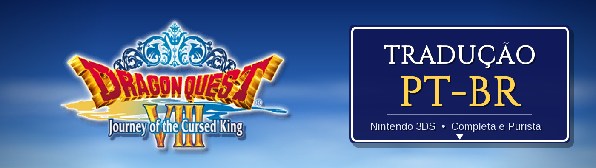
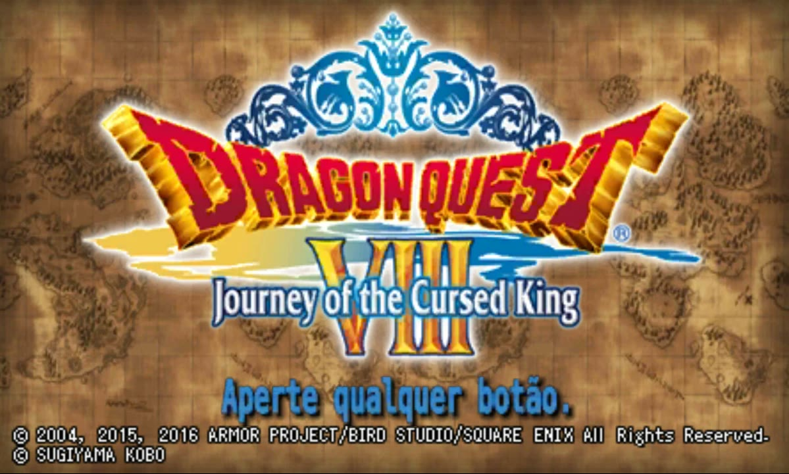
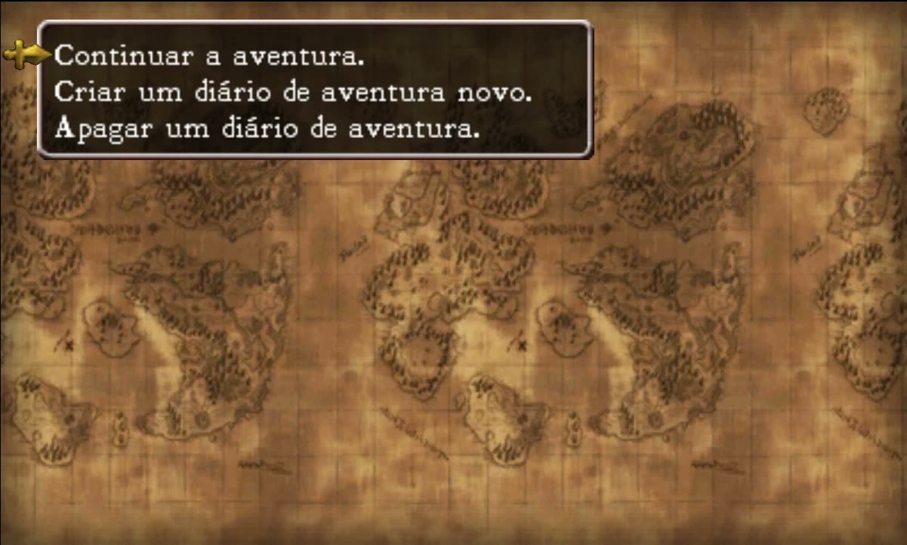
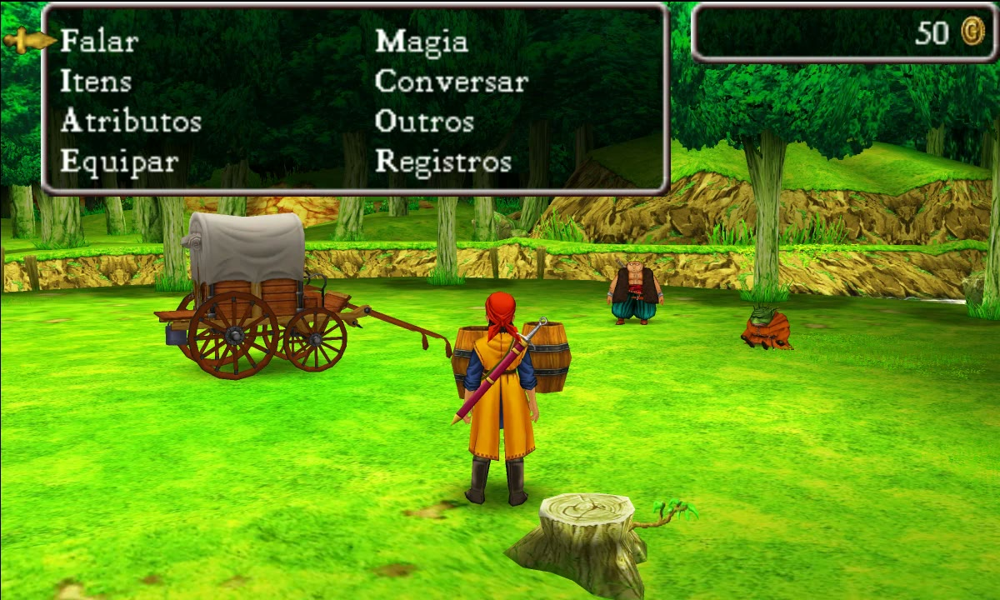
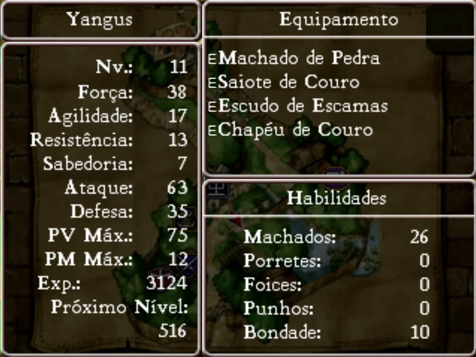
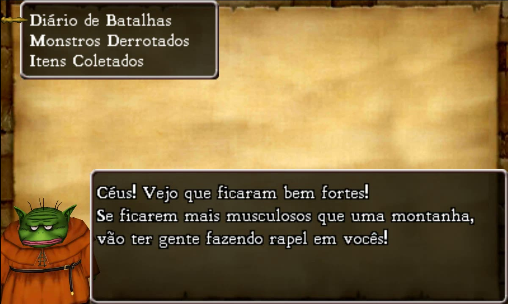
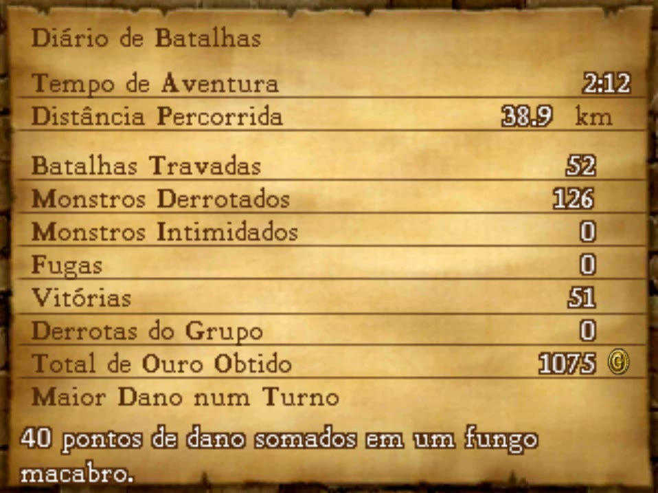
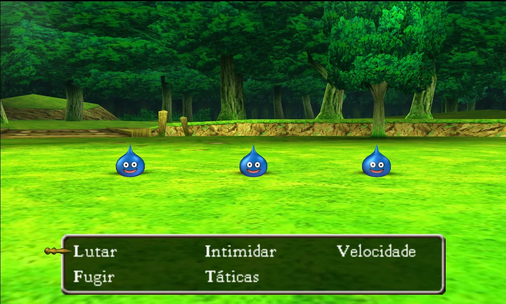
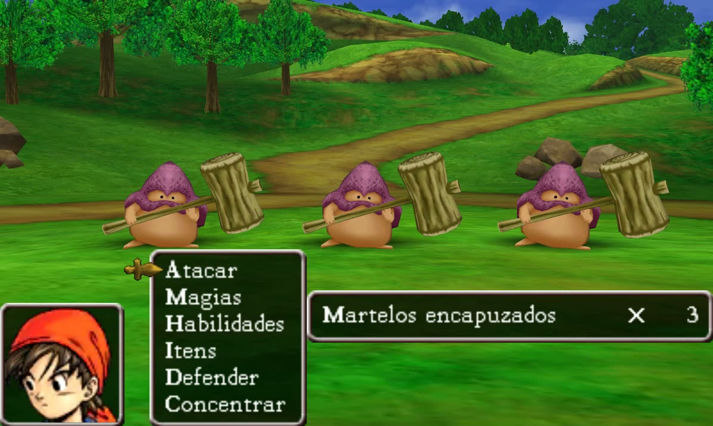

# 🐉 Dragon Quest VIII: Journey of the Cursed King (3DS) — Tradução PT-BR v1.6

-009c3b)
-ce181e)

Tradução de fã do **Dragon Quest VIII: Journey of the Cursed King** (Nintendo 3DS, versão americana).
**Tradução completa para o português do Brasil**, com menus, história, diálogos, magias, itens,
monstros, lugares e imagens com texto em português.

*Feita por fãs, para fãs. Gratuita, sem fins lucrativos e sem nenhuma ligação com a Square Enix (veja o aviso legal no
fim desta página).*

> ✅ O jogo inteiro está traduzido e foi testado no emulador Azahar. Se achar algum problema, abra uma
> [issue](../../issues).

> 🇯🇵 **Na v1.3, todo o texto foi revisado de novo comparando com a versão japonesa do jogo**: nomes, magias, habilidades,
> descrições e todos os diálogos. Foram corrigidos singular/plural e gênero de quem fala, sentidos que o inglês deixava
> ambíguos e expressões traduzidas ao pé da letra, mantendo as piadas e sotaques da versão inglesa.

## 🆕 Novidades da v1.6

- **Versão única em português do Brasil.** O pacote agora traz uma tradução só (a antiga "Nomes Traduzidos").
- **O que ainda estava em inglês agora está em português:** golpes de monstros e da Arena que apareciam em inglês nas
  mensagens de batalha (*Chicotada em Grupo, Megachicotada, Dança Esquisita, Pânico Metálico, Palmada Slime, Golemizador,
  Ataque Defensivo, Desconcentrar, Exibir o Muque*…), o golpe do Morrie *Pit Stop* (agora **Parada Técnica**), "None"
  (**Nenhum**), a **Mulher Fatal**, o **Octávio Máximo**, **O Espeta-Tudo** e a equipe **Os Número Um**
  da Arena.
- **Tryan Gully** agora é o **Vale Triangular** (o nome inglês é um trocadilho com *triângulo*, como no japonês 三角谷), em
  todas as falas, no mapa e nas missões.
- **Apelidos dos monstros da Arena** recriados em português: Treme-Treme (o slime), Babão, Bruxilda, Pesadão, Olhinho,
  Demoninho, Gaviãozinho, Estelar, Cogumago e Abutrão.
- **Interjeições** que ficaram do inglês ("Uuurgh", "Hur hur hur", "Ha ha!") trocadas pelas formas em português, conferindo
  com o japonês o que cada uma é (gemido, ronco, risada, bocejo, tosse): Aaargh, Ronc, Rá rá rá, Uaaah, Ufa...
- Os títulos do Morrie que estavam em inglês agora seguem o italiano dele: **~ Combattente Macho ~** e
  **~ Combattente Muscolo ~**.
- **Ficam como no original**, por decisão: as imagens do cassino (fichas, roleta, bingo e o SLIME BINGO) e os créditos finais.
- A v1.5 trouxe a troca de nomes inventados que não faziam sentido em português (*Draculima → Draculimãe,
  Democrorrobô → Robocrata, Fusão Toupeiricular → Fusão Toupeiratômica*) e a correção de uma fala de Ascantha
  ("vocês vieram").
- Para atualizar a partir de qualquer versão anterior, apague a pasta `000400000018F100` antiga e copie a nova. O save
  continua o mesmo.

## 📸 Fotos

| | |
|---|---|
|  |  |
| Tela de título | Menu do diário de aventura |
|  |  |
| Menu do campo | Atributos e habilidades do Yangus |
|  |  |
| Registros com o Rei Trode | Diário de Batalhas |
|  |  |
| Comandos da batalha | Ações do personagem |

*Fotos no emulador Azahar.*

## 📥 Download (v1.6)

**[⬇️ Baixar `DQ8_3DS_PTBR_v1.6.zip`](../../releases/latest)**: a tradução em pasta **LayeredFS** (é só copiar), o guia
`LEIA-ME.txt` e os termos de uso.

| Dentro do zip | O que é |
|---|---|
| `LayeredFS/000400000018F100/` | A tradução (copie esta pasta) |
| `LEIA-ME.txt` | Guia de instalação |
| `LICENSE.txt` | Termos de uso |

## 🎮 O que foi traduzido

| Parte | Textos | Cobertura |
|---|---|---|
| Diálogos, cenas, conversas do grupo, livros e placas | 28.849 | 100% |
| Menus, itens, magias, habilidades, monstros, batalha, lojas, igreja, Arena, cassino, missões | 7.573 | 100% |
| Imagens com texto (tela de título, estúdio de fotos, etiqueta NOVO, mapa inexplorado) | 5 | as do cassino ficam no original |

- **Tudo a partir do inglês**, a versão famosa pelo humor britânico, pelos sotaques e pelos nomes cheios de
  trocadilhos. Quando o inglês faz piada, a piada foi recriada em português em vez de traduzida ao pé da letra.
- **Cada personagem fala do seu jeito:** o Yangus é malandro e chama o herói de "chefe", o Trode é um rei pomposo, a Red
  é uma malandra durona, o Morrie mistura italiano ("Si, bellissimo!") e há sotaques regionais por todo o mundo.
- **Contexto da história:** cada fala foi traduzida sabendo em que ponto da aventura está e quem está falando.
- **Medidas no lugar:** todo texto foi medido pixel a pixel para caber nas caixas e menus do 3DS.
- **Interface:** PV/PM no lugar de HP/MP, artigos e gênero corretos nas mensagens de batalha ("Causa 20 pontos de dano à
  morcega A!") e ordem alfabética seguindo os nomes em português.

### Alguns exemplos

- **Magias:** *Frizz/Frizzle/Kafrizzle → Fogo/Superfogo/Megafogo · Bang/Boom/Kaboom → Explosão/Superexplosão/Megaexplosão*.
  Os nomes seguem a ideia da versão francesa do jogo (Flamme, Superflamme, Mégaflamme): o prefixo "Ka-" do inglês não faz
  sentido em português, e com Super e Mega dá para ver a força da magia só pelo nome.
- **Habilidades:** *Penny Pincher → Pão-Duro · Hip Drop → Rebolada · Golden Oldies → Velha Guarda*
- **Monstros:** traduzidos, com graça (*Lips → Beiçola · Dracky → Draculino · Troll → Trasgo · Mimic → Mímico*);
  Slime, Golem e Orc ficam, porque já são palavras do português.
- **Chefes com nome-trocadilho:** recriados (*Geyzer → Gêiser · Khalamari → Calamarão · Juggerwroth → Colossira*).
- **Cidades:** os nomes próprios ficam (Farebury, Alexandria, Baccarat); as que são piada foram recriadas
  (*Pickham → Larápia · Simpleton → Simplória · Port Prospect → Porto Promessa*).

## 🚫 O que não foi traduzido (de propósito)

| O quê | Por quê |
|---|---|
| Nomes próprios (Yangus, Jessica, Angelo, Farebury, Baccarat…) | São nomes, iguais em todas as versões do jogo. |
| Logotipo, subtítulo do logotipo ("Journey of the Cursed King") e copyright | Arte e marcas registradas. |
| Imagens do cassino (letreiros, SLIME BINGO, bingo, roleta, fichas) | Fazem parte da arte do cassino; ficam como no original. |
| Falas em italiano do Morrie e em francês da moça do Puff-Puff | De propósito, como no original (o sotaque é a piada). |
| Puff-Puff | Piada clássica da série; o nome é o mesmo em todas as línguas. |
| Slime, Golem e Orc | Nomes de monstros que já são palavras usadas em português. |
| Créditos finais (cargos e nomes da equipe) | Ficam como no original. |
| Vídeos (abertura e "The End") | O texto está gravado no vídeo; a versão europeia usa os mesmos vídeos em inglês. |
| Vozes | Ficam as vozes originais. |

## 💿 O que você precisa

Você precisa da sua **própria cópia** do jogo, versão **americana (USA)**. **Este projeto não distribui o jogo.**

## 💾 Instalação

Copie a pasta `000400000018F100` (de dentro de `LayeredFS`). Funciona com o jogo como você já joga: cartucho, cópia
instalada ou `.3ds`.

- **🖥️ Emulador Azahar (ou Citra/Lime3DS):** clique com o botão direito no jogo → *Open Mods Location* (ou abra a
  pasta `user/load/mods/` do emulador) e copie para lá a pasta `000400000018F100`. O caminho final
  fica `load/mods/000400000018F100/romfs/...`. Feche e abra o jogo.
- **🎮 3DS com Luma3DS:** copie a pasta `000400000018F100` para `SD:/luma/titles/` (o caminho final
  fica `SD:/luma/titles/000400000018F100/romfs/...`). Ligue o console segurando **SELECT** e ative
  **"Enable game patching"** no menu do Luma.
- **Para atualizar** a partir de qualquer versão anterior (v1.0 a v1.5), apague a pasta
  `000400000018F100` antiga e copie a nova. **Para voltar ao inglês**, só apague a pasta.

Saves do jogo em inglês funcionam normalmente.

## 🔒 Segurança

- Baixe a tradução **só pela página de [Releases](../../releases) deste repositório**.
- Faça backup do seu save antes de jogar.

## ❓ Não funcionou?

| Sintoma | Causa provável |
|---|---|
| Continua tudo em inglês (pasta) | A pasta não está no lugar certo: o caminho tem de terminar em `000400000018F100/romfs/`. No 3DS, confira se o "game patching" do Luma está ligado. |
| O jogo não é o americano | A tradução é para a versão **USA** (ID `000400000018F100`). A europeia usa outro ID e não funciona. |
| Textos misturados depois de atualizar | Você carregou um *save state* feito com a versão anterior, ou copiou a pasta nova por cima da antiga. Apague a pasta, copie de novo e continue pelo save normal. |
| Travamento | Abra uma issue informando onde aconteceu. |

## 🐞 Achou um erro?

Abra uma [issue](../../issues/new/choose) usando o formulário "Erro na tradução". Informe a versão do patch, o lugar do jogo e, se puder, mande um print. Toda correção de português também é bem-vinda.

## 🙏 Créditos

- **Tradução, revisão e ferramentas:** [0xdhx0](https://github.com/0xdhx0).
- **Fontes livres** usadas nas imagens: Anton, Arimo e Russo One (licença OFL) e DejaVu (licença livre).

**Como foi feita:** a tradução usou ferramentas de IA. Todo o texto foi traduzido a partir do inglês com o contexto da
história e o jeito de falar de cada personagem, conferido pixel a pixel para caber na tela e testado no Azahar. Se achar
uma frase estranha, abra uma [issue](../../issues), porque toda sugestão ajuda.

## ⚖️ Aviso legal e uso

- Esta é uma **tradução feita por fãs, para fãs**, **gratuita** e **sem fins lucrativos**.
- **Não temos nenhuma ligação** com a Square Enix ou qualquer outra empresa envolvida no jogo. O projeto não é oficial,
  nem aprovado ou apoiado por elas.
- *Dragon Quest VIII: Journey of the Cursed King* e todos os nomes, marcas e personagens pertencem aos seus donos
  (© ARMOR PROJECT/BIRD STUDIO/LEVEL-5/SQUARE ENIX).
- O pacote contém **só os arquivos de texto e imagem alterados pela tradução** (pasta LayeredFS) e **não funciona sem
  uma cópia do jogo original**. O jogo não é distribuído aqui: não peça nem
  compartilhe ROMs (`.3ds`, `.cia`) neste repositório.
- Pode usar e compartilhar o patch à vontade, **de graça**. Ele **não pode ser vendido** nem monetizado. Se alguém
  cobrou por ele, você foi enganado. Veja [LICENSE.txt](LICENSE.txt).
- Se você é detentor de algum direito e quer que algo seja retirado, abra uma issue ou entre em contato pelo GitHub.

Apoie a franquia comprando os jogos oficiais.
